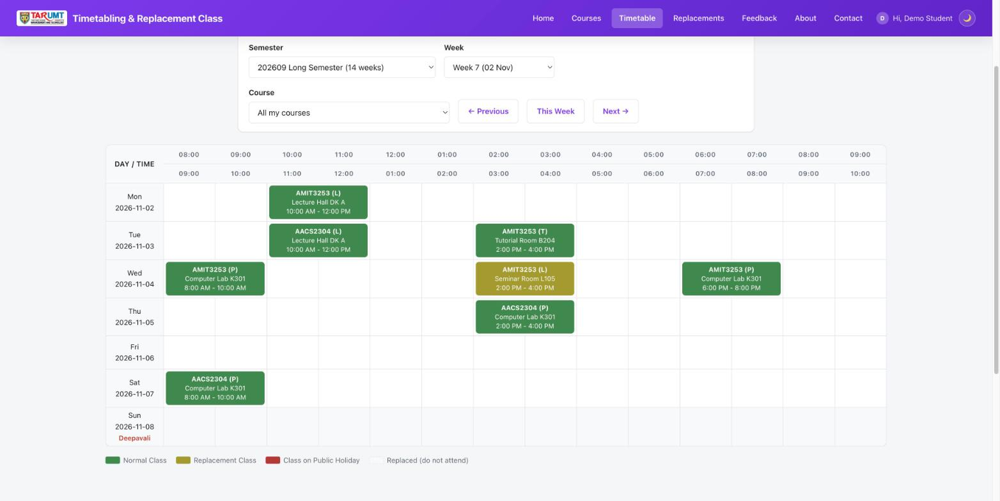
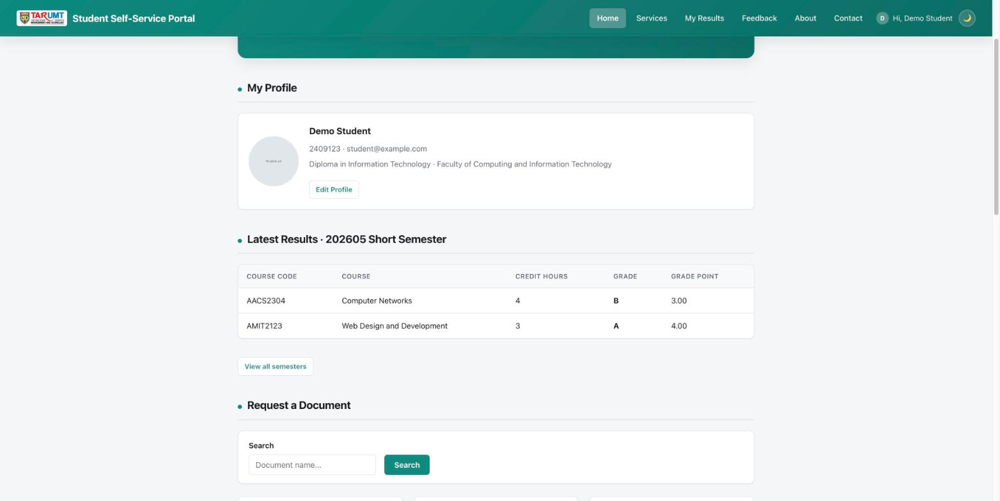
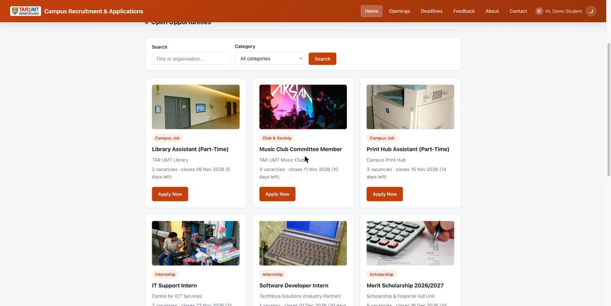
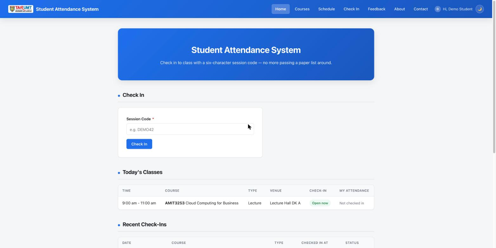
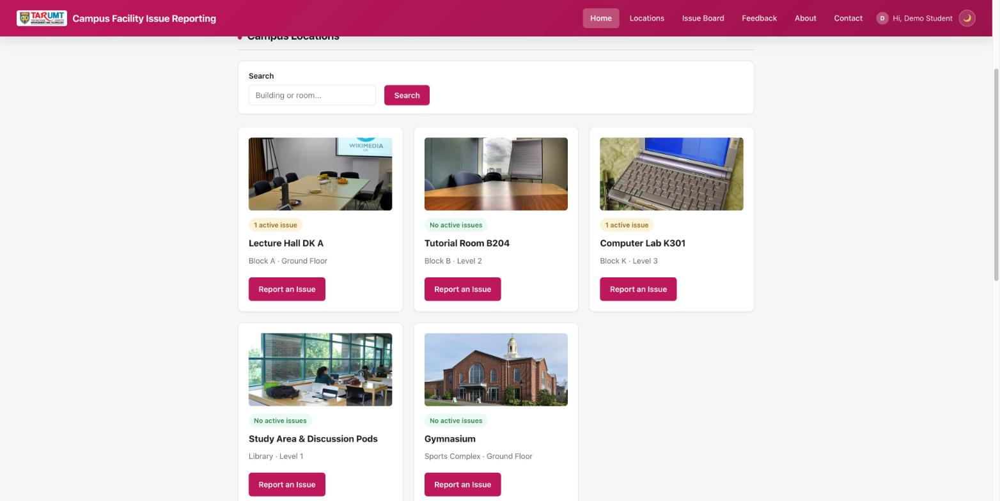

# AMIT3253 Cloud Computing for Business (202609)

Assignment brief and sample applications for the 202609 capstone: **AWS Cloud Challenge:
Deploying a Scalable and Secure Campus Digital Services Platform**.

- [`AMIT3253 Assignment (202609).md`](AMIT3253%20Assignment%20(202609).md) — the assignment brief.
- Five sample web applications, one per example scenario in the brief. Each is a ready-to-use
  PHP + MySQL app, so students can focus on the AWS infrastructure (VPC, EC2, RDS, ELB, ASG)
  instead of writing app code from scratch.

**Each group uses only one of these folders** — they don't need to read or reference the others.

| Folder | Scenario | Core transaction |
|---|---|---|
| [`timetabling-replacement-class/`](timetabling-replacement-class/) | Timetabling & Replacement Class System | Lecturers request replacement classes; admin approves; the weekly timetable updates |
| [`student-self-service/`](student-self-service/) | Student Self-Service Portal | Students check results and request official documents |
| [`campus-recruitment/`](campus-recruitment/) | Campus Recruitment & Application Platform | Students apply for campus jobs, internships, club positions and scholarships |
| [`student-attendance/`](student-attendance/) | Student Attendance System | Lecturers open check-in; students check in with a one-time code |
| [`facility-issue-reporting/`](facility-issue-reporting/) | Campus Facility Issue Reporting System | Students and staff report broken facilities and follow the repair status |

## Screenshots

Each app has its own colour so they're easy to tell apart.

| | |
|---|---|
| **Timetabling & Replacement Class** (purple)  | **Student Self-Service Portal** (teal)  |
| **Campus Recruitment & Applications** (orange)  | **Student Attendance System** (blue)  |
| **Campus Facility Issue Reporting** (magenta)  | |

## What every app includes

Each folder is self-contained and follows the same structure and conventions:

- **`schema.sql`** creates the database, tables and sample data, including demo accounts
  (`admin@example.com` / `admin123`, `student@example.com` / `student123`, and
  `lecturer@example.com` / `lecturer123` for the two apps with lecturers).
- **`config.php`** reads `DB_HOST`, `DB_USER`, `DB_PASS`, `DB_NAME` from environment variables or
  a `.env` file, so the same code runs locally, on EC2 and against RDS. It also sets the PHP and
  MySQL timezone to `Asia/Kuala_Lumpur`.
- **Ready for multiple instances behind a load balancer**: PHP sessions are stored in the
  database, `healthz.php` gives the ALB a health check that fails when the database is
  unreachable, and photo uploads can go to S3 instead of local disk.
- **Accounts**: register/login/logout and an account page; passwords hashed with
  `password_hash()`. The two apps with lecturers add a `role` column; lecturer accounts are
  created by an admin. In the Student Attendance, Timetabling and Student Self-Service systems
  there is no public registration — the admin creates every account (and, for attendance and
  timetabling, enrols students in their courses). Campus Recruitment and Facility Issue Reporting
  allow self-registration, since anyone on campus should be able to apply or report a problem.
- **Login required everywhere**: every page except the login page (and `healthz.php`, for the
  load balancer) redirects to login, enforced in one place in `auth.php`.
- **A main read flow and a main write flow** (view records → submit a transaction → see it
  saved), with ownership checks (users only edit their own records) and status workflows.
- **Concurrency-safe business rules** — row locks (`SELECT ... FOR UPDATE`) inside transactions
  and unique keys — so duplicate or conflicting records can't slip through under load, plus
  dropdowns that grey out unavailable options via a small JSON endpoint.
- **Admin panel** (`admin/`): manage the main records, move requests through their workflow,
  manage reference data (with photo upload), moderate feedback, read contact messages, and
  manage user accounts.
- Contact form, feedback page, dark/light mode, prepared statements throughout, and all output
  escaped with `htmlspecialchars()`.

See each folder's `README.md` for its features, demo data, and step-by-step EC2/RDS deployment.
