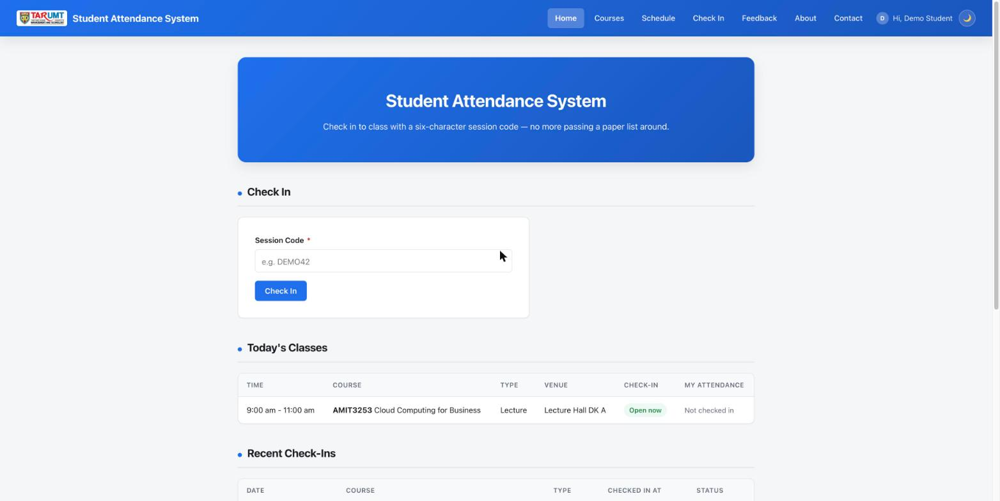
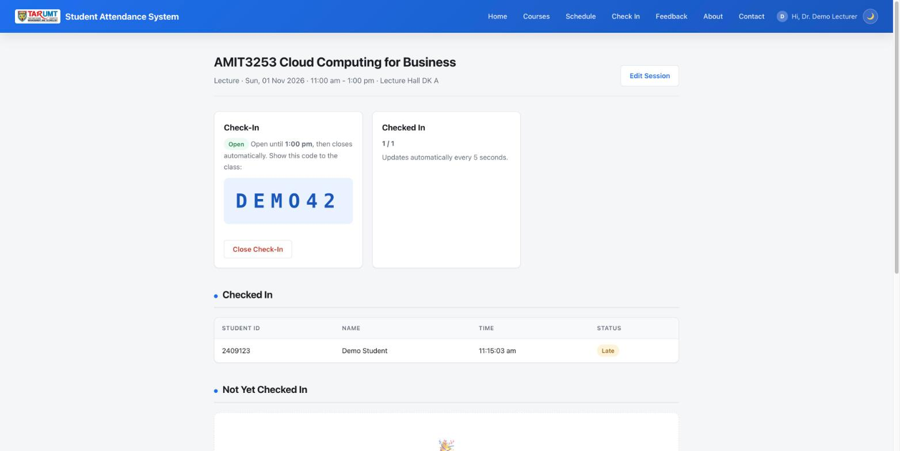
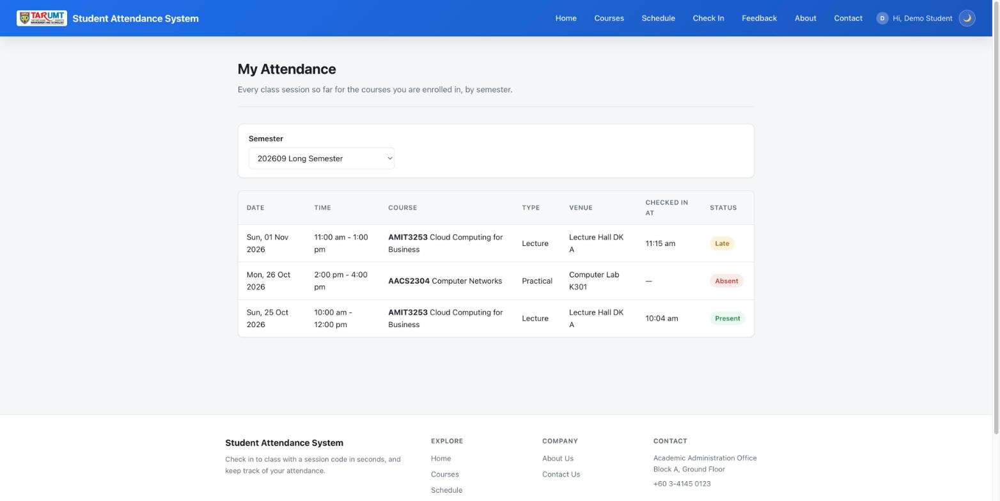

# Student Attendance System

A PHP + MySQL web app for the **AMIT3253 Cloud Computing for Business** capstone assignment
(202609). Lecturers open check-in for a class and show a one-time code; students enter the code to record their attendance as Present or Late. Use this folder as-is as your Phase 2/3 starting point so you can focus on
the AWS infrastructure (VPC, EC2, RDS, ELB, ASG) instead of writing app code from scratch.


*Student homepage — check in with the check-in code and see today's classes.*


*Lecturer's class page — the check-in code to project in class and a live list of who has checked in.*


*My Attendance — every class so far in the chosen semester, marked Present, Late or Absent.*

## Features

> **Naming:** on screen, one meeting of a course (a specific date, time and venue) is called a
> **class**. In the code it's a row in the `class_sessions` table, and its pages are `sessions.php`
> and `session_*.php`. This is unrelated to the PHP login sessions stored in the `sessions` table.

**Semesters**
- A year has two **long semesters (14 weeks)** and one **short semester (7 weeks)**, set up by the
  admin. Students are enrolled per semester, and every class falls within a semester.

**Students**
- See the courses they're enrolled in for a chosen semester on **My Courses**. Enrolment is done
  by the admin, not by students themselves.
- **Check in** by entering the six-character code shown in class (homepage or `checkin.php`).
  Check-in only works while the class is open for check-in, on the day of the class, for
  courses the student is enrolled in. Checking in more than 15 minutes after the start time is
  recorded as **Late**.
- **Check-in closes automatically when the class ends** (`class_sessions.open_until`), so a code
  shared after class is useless. Only the lecturer can reopen it.
- **Concurrency-safe and idempotent**: the class's row is locked (`SELECT ... FOR UPDATE`)
  while checking it's still open, and a unique key on (class, student) means a double
  submit can never create two records — the second attempt just reports "already checked in".
- "Today's Classes" and "Recent Check-Ins" on the homepage; **`my_attendance.php`** lists every
  class so far in a chosen semester with Present / Late / Absent.
- **`schedule.php`**: upcoming classes for your enrolled courses.
- Login/logout, account page (Student ID is set by the admin and can't be changed by the user), dark/light mode, password visibility toggle, TAR UMT
  faculty dropdown. Contact form and feedback page, moderated by admin.

**Lecturers** (accounts created by an admin, `users.role = 'lecturer'`)
- "Today's Classes" and "My Courses" on the homepage; **`sessions.php`** lists every class
  for the courses they teach, filtered by semester and course. **My Courses** shows only the
  courses they teach.
- The admin sets up each semester's regular classes; lecturers add **extra or one-off classes**
  for their own courses (date, start/end time, venue, class type, optionally repeated weekly), and
  edit or delete their classes. A class students have already checked in to can't be deleted.
- **Open check-in** on the day of the class: a fresh six-character code is generated each
  time (no look-alike characters such as 0/O or 1/I), shown large for projecting. It stays open
  until the class's end time and then closes by itself; the lecturer can also close it early.
- **Reopen after class**: once a class has ended, the lecturer can reopen check-in for 15
  minutes (`REOPEN_MINUTES` in `helpers.php`) with a fresh code, e.g. for a student who had
  trouble checking in.
- **Live roster**: `session_view.php` polls **`session_status.php`** every 5 seconds, so
  students appear as they check in, plus a list of enrolled students not yet checked in.

**Admin panel** (`admin/`, gated by `is_admin`; admins land on `admin/sessions.php`)
- **Semesters** (`admin/semesters.php`): add long (14-week) or short (7-week) semesters by code and
  start date; overlapping semesters are rejected.
- **Schedule the semester's regular classes** (`admin/session_create.php`) for any course: date,
  time, venue and type, with **Repeat weekly** for up to 14 weeks (stopping at the end of the
  semester).
- **Enrol students in courses per semester** (`admin/enrolments.php`): pick a semester and course,
  select several students at once, and remove them again if needed (past attendance records are
  kept). Only students enrolled for that semester can check in to a course's classes.
- View every class across all courses (filtered by semester), the full attendance roster for any class, and
  remove an individual check-in (e.g. to correct a mistake). Delete a class together with its
  attendance records.
- Full CRUD for courses (with lecturer assignment and photo upload).
- Moderate feedback and view contact messages.
- **Create every account** (`admin/user_create.php`): students (with Student ID, faculty, and
  optionally the courses to enrol them in), lecturers and admins. Duplicate emails and Student/Staff
  IDs are rejected.
- Manage user accounts: promote/demote admin access,
  delete an account (cascades to their enrolments, attendance and feedback; courses they taught
  become unassigned). An admin can never delete or demote their own account.

There's deliberately **no admin dashboard** (`admin/index.php`).

## Demo accounts

Seeded by `schema.sql`:

| Email | Password | Role |
|---|---|---|
| `admin@example.com` | `admin123` | Admin (lands on the admin panel) |
| `lecturer@example.com` | `lecturer123` | Lecturer |
| `student@example.com` | `student123` | Student |

Today's **AMIT3253 Cloud Computing for Business** lecture is seeded as already open for
check-in with code **`DEMO42`**, so you can log in as the student and check in straight away.

**Change these passwords (or the seed rows in `schema.sql`) before deploying anywhere beyond a
local demo** — they're well-known credentials once this code is shared. There is **no public registration**: an admin creates every student, lecturer and admin account from **Users → Add User**.

## Ideas for additional functions

The functions above are already provided. If you want to build something new on top of
them, here are some ideas to start from. Each one adds new behaviour that reads and writes
the database, and can be built with the same query and page patterns used elsewhere in this
app. You are welcome to come up with your own instead.

| Idea | Effort | What it involves |
|---|---|---|
| **Attendance percentage** | Easy | On `my_attendance.php`, show each course's attendance % (Present + Late ÷ classes so far) and highlight courses below 80%. Reads `attendance`, `class_sessions`, `enrolments`. |
| **Lecturer attendance report** | Easy | A page for lecturers listing every enrolled student's attendance % for one course, with a low-attendance warning list. |
| **Manual mark by lecturer** | Easy | Let a lecturer mark a student Present/Late from `session_view.php` (e.g. a student whose phone died). Insert into `attendance`, checking the student is enrolled. |
| **Photo proof on check-in** | Moderate | Add a photo field to the check-in form (`<input type="file" accept="image/*" capture="user">` opens the phone camera or the photo library). Reuse `handle_image_upload()` to store it — on S3, so every instance behind the load balancer can show it — add a `photo_url` column to `attendance`, and show the photo on the lecturer's live roster. Bonus: keep the bucket private and show photos through time-limited (pre-signed) links. |
| **Absence with valid reason (MC)** | Moderate | Students submit a reason (and optionally a medical certificate photo, uploaded with the existing `handle_image_upload()` helper) for an Absent class; the lecturer approves it and it shows as **Excused**. New `absence_requests` table. |
| **Edit user** | Easy | An `admin/user_edit.php` page so an admin can correct a student's name, Student ID or faculty without deleting the account. |
| **Bulk-create students from CSV** | Moderate | Upload a CSV (name, email, Student ID, faculty, course codes) to create many student accounts and enrolments at once. |

Document any function you add in your report: what it does, before/after screenshots, and the
tables or columns it uses.

## Tech stack

Plain procedural PHP (no framework) + MySQL via `mysqli`. All queries use prepared
statements and all output is escaped with `htmlspecialchars()`.

## Requirements

- PHP 8.x with the `mysqli` extension
- MySQL 5.7+ / MariaDB / Amazon RDS (MySQL-compatible)
- A web server (Apache/Nginx) or just `php -S` for local testing

## Quick start (local)

1. Create the database and import the schema (this also creates the database and seeds the
   demo accounts and sample data):
   ```
   mysql -u root -p < schema.sql
   ```
2. Point `config.php` at your MySQL instance — either copy `.env.example` to `.env` and fill in
   `DB_HOST`/`DB_USER`/`DB_PASS`/`DB_NAME`, or export them as environment variables:
   ```
   DB_HOST=localhost DB_USER=root DB_PASS=yourpassword DB_NAME=attendance_db
   ```
3. Serve the folder, e.g.:
   ```
   php -S localhost:8000
   ```
4. Visit `http://localhost:8000/` and log in with one of the demo accounts above.

Sample data with dates (classes, deadlines, replacement classes) is relative to the day you
import `schema.sql`, so the demo always has current data. Re-import it to reset.

## Project structure

| Path | Purpose |
|---|---|
| `schema.sql` | Creates the database, all tables (`users`, `courses`, `semesters`, `enrolments`, `class_sessions`, `attendance`, `feedback`, `contact_messages`, `sessions`) and seed data |
| `config.php` | Database connection — reads `DB_HOST`/`DB_USER`/`DB_PASS`/`DB_NAME` (environment or `.env`), plus S3 photo storage config |
| `healthz.php` | ALB health check target — `200` if the DB connection works, `500` otherwise |
| `auth.php` | Database-backed PHP sessions + helpers: `current_user_id()`, `require_login()`, `require_admin()`, `require_lecturer()` |
| `helpers.php` | Image upload/delete (local or S3), faculty list, and this app's own helpers |
| `index.php` | Homepage: check-in box + today's classes (students) or today's classes (lecturers) |
| `checkin.php` | Enter a check-in code to check in |
| `courses.php` | Course list, with the student's enrolled courses marked |
| `schedule.php`, `my_attendance.php` | Upcoming classes; personal attendance history |
| `sessions.php`, `session_*.php` | Lecturer class management, check-in toggle and live roster |
| `login.php` / `logout.php` / `account.php` | Accounts (passwords hashed with `password_hash()`, never plaintext) |
| `about.php`, `contact.php`, `feedback.php` | Informational pages, contact form, feedback |
| `partials/` | Shared navbar/footer, included by every page |
| `admin/` | Admin-only pages |
| `uploads/` | Uploaded photos (when S3 isn't configured) |
| `style.css` | Shared styling (navbar, cards, forms, tables, dark/light mode) |

## Running behind a load balancer

Two things that break when a PHP app runs on more than one EC2 instance are already handled:

- **Sessions are stored in the database** (the `sessions` table, see `auth.php`), not on local
  disk — so a user stays logged in whichever instance the ALB sends their next request to.
- **`healthz.php`** returns `200` only if the database connection succeeds (`500` otherwise).
  Point your target group's health check at it so an instance that can't reach RDS is pulled
  out of rotation.

The third — uploaded photos — is covered next.

## Photos: local disk by default, S3 already wired up (just needs your bucket)

Admins can upload a photo for each course. Uploads are validated with
`getimagesize()` (not just the file extension) and capped at 5MB. Where they're stored depends
on `AWS_S3_BUCKET`:
- **Unset (default)**: saved into `uploads/`, and `image_url` stores a path like
  `/uploads/xxx.jpg`. Nothing to configure.
- **Set**: uploaded to that S3 bucket instead (hand-written Signature Version 4 signing over
  PHP's built-in stream wrapper — no AWS SDK, no Composer), and `image_url` stores the full
  object URL.

Once there's more than one EC2 instance behind the ALB, a photo saved to local disk only exists
on the instance that handled the upload, so the others show a broken image — S3 fixes this.
Switching S3 on only affects *new* uploads; the seeded sample photos stay local.

Credentials are tried two ways: first an IAM role attached to the EC2 instance (via the
metadata service, nothing hardcoded), then explicit `AWS_ACCESS_KEY_ID` /
`AWS_SECRET_ACCESS_KEY` / `AWS_SESSION_TOKEN` — e.g. from an AWS Academy Learner Lab's "AWS
Details" panel — set in `.env` (copy `.env.example`; `.env` is git-ignored so it's never
committed). Learner Lab credentials expire and rotate; if uploads suddenly fail, refresh them.
**What's still on you**: creating the bucket and a public-read bucket policy (or CloudFront),
getting one of the two credential methods working, and setting `AWS_S3_BUCKET`/`AWS_S3_REGION`.

Notes for EC2 deployment:
- `uploads/` needs to be writable by the web server user: `chmod 775 uploads`.
- PHP's default `upload_max_filesize` (often 2M) is smaller than the 5MB this app allows —
  raise `upload_max_filesize` / `post_max_size` in `php.ini` and restart the web server.

## Phase 2: running it on a single EC2 instance

1. **Launch the instance**: Amazon Linux 2023 AMI, `t2.micro`/`t3.micro`, with a key pair.
2. **Security group**: inbound `SSH (22)` from your IP only and `HTTP (80)` from `0.0.0.0/0`.
3. **Connect**: `ssh -i your-key.pem ec2-user@<public-ipv4>`
4. **Install a LAMP stack**:
   ```
   sudo dnf install -y httpd php php-mysqli mariadb105-server
   sudo systemctl enable --now httpd mariadb
   ```
5. **Copy this folder onto the instance** (from your own machine):
   ```
   scp -i your-key.pem -r ./student-attendance ec2-user@<public-ipv4>:/tmp/
   ```
   Then on the instance:
   ```
   sudo cp -r /tmp/student-attendance/. /var/www/html/
   sudo chown -R apache:apache /var/www/html
   sudo chmod -R 775 /var/www/html/uploads
   ```
6. **Import the schema**: `sudo mysql_secure_installation`, then `mysql -u root -p < schema.sql`
7. **Point the app at the database**: copy `.env.example` to `.env` and set `DB_HOST`/`DB_USER`/
   `DB_PASS`/`DB_NAME`.
8. **Test it**: open `http://<public-ipv4>/`.

## Phase 3: moving the database to RDS

1. Create an RDS MySQL instance in a private subnet (per the assignment's VPC design).
2. From an EC2 instance in the same VPC, import the schema:
   ```
   mysql -h <rds-endpoint> -u <user> -p < schema.sql
   ```
3. Set `DB_HOST` (and `DB_USER`/`DB_PASS`/`DB_NAME` if different) in `.env` to the RDS
   endpoint — `config.php` doesn't need to change.
4. Restrict the RDS security group to accept port 3306 only from the web tier's security group.

## Load testing

Good targets for Apache Bench / JMeter / Locust: `checkin.php` — hundreds of students checking in within the first minutes of a class is this system's natural spike. Every page except
`login.php` and `healthz.php` needs a login, so your load test must first POST to `login.php`
(with a demo account), keep the session cookie it gets back, and send that cookie with every
request — Locust and JMeter both do this with a cookie manager / client session. `healthz.php`
needs no cookie but only checks the database connection, so it isn't a realistic test on its own.

## Login is required

**Every page needs a login** except `login.php` (and
`healthz.php`, which the load balancer calls). This is enforced in one place: the
`PUBLIC_PAGES` check at the bottom of `auth.php`, which every page loads, so a new page you add
is protected automatically. Logged-out visitors are redirected to the login page, and the
navigation is hidden until they log in.

This login identifies who is using the system; it's not a substitute for real campus
authentication (SSO/VPN), which is out of scope for this proof of concept.
