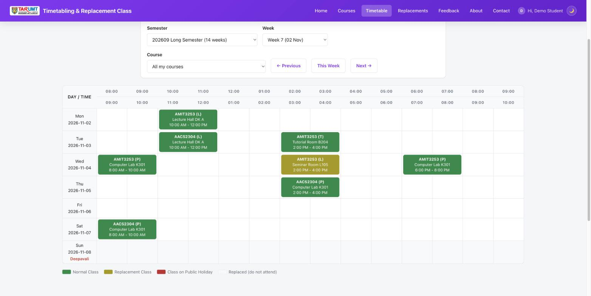
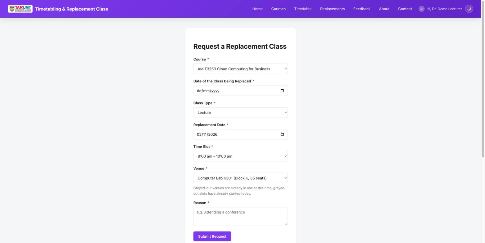
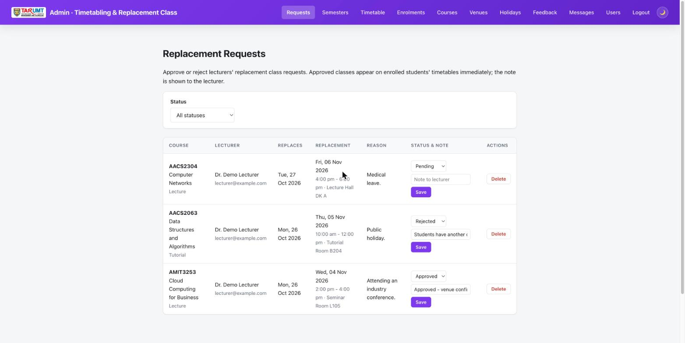

# Timetabling & Replacement Class System

A PHP + MySQL web app for the **AMIT3253 Cloud Computing for Business** capstone assignment
(202609). Students and lecturers view the weekly class timetable; lecturers request replacement classes, which appear on the timetable once an admin approves them. Use this folder as-is as your Phase 2/3 starting point so you can focus on
the AWS infrastructure (VPC, EC2, RDS, ELB, ASG) instead of writing app code from scratch.


*Semester timetable (student view) — only their enrolled courses; the replacement class is shown in olive and Deepavali is marked.*


*Lecturer's replacement class request — venues already in use at that time are greyed out.*


*Admin — approve or reject replacement requests with a note to the lecturer.*

## Features

**Semesters**
- A year has two **long semesters (14 weeks)** and one **short semester (7 weeks)**, set up by the
  admin. The weekly timetable and student enrolments belong to a semester.

**Every logged-in user**
- Homepage: **My Courses** for the current semester (a student's enrolled courses, a lecturer's
  own courses, or every course for admins), with search, plus a **Courses** page listing every
  course's regular weekly classes (the full catalogue).
- Contact form and feedback page (topic + star rating), both moderated by admin.
- **There is no public registration** — the admin creates every account.

**Students**
- **`timetable.php`**: their own semester timetable — **only the courses they're enrolled in**
  that semester. Days (Monday–Sunday, with dates) are rows and hourly columns (8:00 am–10:00
  pm) are columns, each class spanning its hours. Filter by semester and **Week 1–14** (or 1–7),
  with previous/this/next week buttons. Classes are colour-coded: **green** normal, **olive**
  replacement, **red** a class that falls on a public holiday, and greyed out/struck through for
  a class that has been replaced. Hover over a class for its full name, lecturer and venue.
  Public holidays are named under their date.
- **`replacements.php`** and the homepage: upcoming approved replacement classes for their
  enrolled courses.
- Login/logout, account page (the Student/Staff ID is set by the admin and can't be changed),
  dark/light mode, password visibility toggle.

**Lecturers** (accounts created by an admin, `users.role = 'lecturer'`)
- See the same semester timetable and replacement list, for the courses they teach.
- Request a replacement class for a course they teach: the date of the class being replaced,
  a replacement date, a fixed time slot (from `time_slots`, not free text), a venue and a
  reason. "My Replacement Requests" on the homepage, with edit/withdraw while Pending.
- **Venue clashes are prevented concurrency-safely.** A venue is busy if a regular weekly class
  uses it on that weekday and slot, or another Pending/Approved replacement holds it. The venue
  row is locked (`SELECT ... FOR UPDATE`) and the clash check + insert run in one transaction,
  so two lecturers can't be promised the same room at the same instant.
- **You can't even select a busy venue.** The venue dropdown greys out venues already in use for
  the chosen date and slot (a fetch to **`venue_availability.php`**), and slots that have already
  started today are greyed out too. The server re-checks everything on submit.
- The original date must be a day the course actually has a regular class that semester; the
  replacement must be in the **same semester**, Monday–Saturday, not on a public holiday, and
  not in the past.

**Admin panel** (`admin/`, gated by `is_admin`; admins land on `admin/replacements.php`)
- Approve/reject replacement requests with a note shown to the lecturer. Re-approving a
  previously rejected request re-checks that its venue is still free.
- **Semesters** (`admin/semesters.php`): add long (14-week) or short (7-week) semesters by code
  (e.g. 202609) and the Monday week 1 starts; overlapping semesters are rejected.
- Manage the regular weekly timetable per semester (`admin/timetable.php`) — a database unique
  key stops two classes being put in the same venue, day and slot.
- **Enrol students** in courses per semester (`admin/enrolments.php`), several at once.
- Full CRUD for courses (with lecturer assignment) and venues (with photo upload).
- Manage **public holidays** (`admin/holidays.php`), shown on the timetable.
- Moderate feedback and view contact messages.
- **Create every account** (`admin/user_create.php`): students (with Student ID, faculty and
  optionally their courses for a semester), lecturers and admins. Duplicate emails and IDs are
  rejected.
- Manage user accounts: promote/demote admin access, delete an account (cascades to their
  enrolments, replacement requests and feedback; courses they taught become unassigned). An admin can never delete or demote their own account.

There's deliberately **no admin dashboard** (`admin/index.php`).

## Demo accounts

Seeded by `schema.sql`:

| Email | Password | Role |
|---|---|---|
| `admin@example.com` | `admin123` | Admin (lands on the admin panel) |
| `lecturer@example.com` | `lecturer123` | Lecturer |
| `student@example.com` | `student123` | Student |

**Change these passwords (or the seed rows in `schema.sql`) before deploying anywhere beyond a
local demo** — they're well-known credentials once this code is shared. There is **no public registration**: an admin creates every student, lecturer and admin account from **Users → Add User**.

## Ideas for additional functions

The functions above are already provided. If you want to build something new on top of
them, here are some ideas to start from. Each one adds new behaviour that reads and writes
the database, and can be built with the same query and page patterns used elsewhere in this
app. You are welcome to come up with your own instead.

| Idea | Effort | What it involves |
|---|---|---|
| **Copy timetable to a new semester** | Easy | A button on `admin/timetable.php` that copies every class from one semester into another, so the admin doesn't re-enter them. |
| **Lecturer clash check** | Easy | When a lecturer requests a replacement, also reject it if they already teach another class in the same date and slot. Extends `replacement_error()` in `helpers.php`. |
| **Cancel a class without replacement** | Easy | Let a lecturer cancel a single class (date + reason); show it struck through on the timetable. New `cancelled_classes` table. |
| **Venue capacity check** | Easy | Add an expected class size to courses and grey out venues whose `capacity` is too small. |
| **Printable / CSV timetable** | Easy | A button on `timetable.php` that downloads the week's classes as a CSV file. |
| **Admin dashboard** | Easy | An `admin/index.php` with counts: pending requests, approved this week, busiest venue. |

Document any function you add in your report: what it does, before/after screenshots, and the
tables or columns it uses.

## Tech stack

Plain procedural PHP (no framework) + MySQL via `mysqli`. All queries use prepared
statements and all output is escaped with `htmlspecialchars()`.

## Requirements

- PHP 8.x with the `mysqli` extension
- MySQL 5.7+ / MariaDB / Amazon RDS (MySQL-compatible)
- A web server (Apache/Nginx) or just `php -S` for local testing

## Quick start (local)

1. Create the database and import the schema (this also creates the database and seeds the
   demo accounts and sample data):
   ```
   mysql -u root -p < schema.sql
   ```
2. Point `config.php` at your MySQL instance — either copy `.env.example` to `.env` and fill in
   `DB_HOST`/`DB_USER`/`DB_PASS`/`DB_NAME`, or export them as environment variables:
   ```
   DB_HOST=localhost DB_USER=root DB_PASS=yourpassword DB_NAME=timetabling_db
   ```
3. Serve the folder, e.g.:
   ```
   php -S localhost:8000
   ```
4. Visit `http://localhost:8000/` and log in with one of the demo accounts above.

Sample data with dates (sessions, deadlines, replacement classes) is relative to the day you
import `schema.sql`, so the demo always has current data. Re-import it to reset.

## Project structure

| Path | Purpose |
|---|---|
| `schema.sql` | Creates the database, all tables (`users`, `courses`, `venues`, `time_slots`, `semesters`, `timetable_entries`, `enrolments`, `public_holidays`, `replacement_classes`, `feedback`, `contact_messages`, `sessions`) and seed data |
| `config.php` | Database connection — reads `DB_HOST`/`DB_USER`/`DB_PASS`/`DB_NAME` (environment or `.env`), plus S3 photo storage config |
| `healthz.php` | ALB health check target — `200` if the DB connection works, `500` otherwise |
| `auth.php` | Database-backed PHP sessions + helpers: `current_user_id()`, `require_login()`, `require_admin()`, `require_lecturer()` |
| `helpers.php` | Image upload/delete (local or S3), faculty list, and this app's own helpers |
| `index.php` | Homepage: course cards + My Replacement Requests (lecturers) or Upcoming Replacement Classes |
| `timetable.php` | Semester timetable by week, with replacements applied (logged-in users, own courses only) |
| `courses.php`, `replacements.php` | Course list with weekly classes; approved replacements |
| `create.php` / `edit.php` / `delete.php` | Replacement request CRUD (lecturers, own requests only) |
| `venue_availability.php` | JSON endpoint used to grey out busy venues |
| `login.php` / `logout.php` / `account.php` | Accounts (passwords hashed with `password_hash()`, never plaintext) |
| `about.php`, `contact.php`, `feedback.php` | Informational pages, contact form, feedback |
| `partials/` | Shared navbar/footer, included by every page |
| `admin/` | Admin-only pages |
| `uploads/` | Uploaded photos (when S3 isn't configured) |
| `style.css` | Shared styling (navbar, cards, forms, tables, dark/light mode) |

## Running behind a load balancer

Two things that break when a PHP app runs on more than one EC2 instance are already handled:

- **Sessions are stored in the database** (the `sessions` table, see `auth.php`), not on local
  disk — so a user stays logged in whichever instance the ALB sends their next request to.
- **`healthz.php`** returns `200` only if the database connection succeeds (`500` otherwise).
  Point your target group's health check at it so an instance that can't reach RDS is pulled
  out of rotation.

The third — uploaded photos — is covered next.

## Photos: local disk by default, S3 already wired up (just needs your bucket)

Admins can upload a photo for each venue. Uploads are validated with
`getimagesize()` (not just the file extension) and capped at 5MB. Where they're stored depends
on `AWS_S3_BUCKET`:
- **Unset (default)**: saved into `uploads/`, and `image_url` stores a path like
  `/uploads/xxx.jpg`. Nothing to configure.
- **Set**: uploaded to that S3 bucket instead (hand-written Signature Version 4 signing over
  PHP's built-in stream wrapper — no AWS SDK, no Composer), and `image_url` stores the full
  object URL.

Once there's more than one EC2 instance behind the ALB, a photo saved to local disk only exists
on the instance that handled the upload, so the others show a broken image — S3 fixes this.
Switching S3 on only affects *new* uploads; the seeded sample photos stay local.

Credentials are tried two ways: first an IAM role attached to the EC2 instance (via the
metadata service, nothing hardcoded), then explicit `AWS_ACCESS_KEY_ID` /
`AWS_SECRET_ACCESS_KEY` / `AWS_SESSION_TOKEN` — e.g. from an AWS Academy Learner Lab's "AWS
Details" panel — set in `.env` (copy `.env.example`; `.env` is git-ignored so it's never
committed). Learner Lab credentials expire and rotate; if uploads suddenly fail, refresh them.
**What's still on you**: creating the bucket and a public-read bucket policy (or CloudFront),
getting one of the two credential methods working, and setting `AWS_S3_BUCKET`/`AWS_S3_REGION`.

Notes for EC2 deployment:
- `uploads/` needs to be writable by the web server user: `chmod 775 uploads`.
- PHP's default `upload_max_filesize` (often 2M) is smaller than the 5MB this app allows —
  raise `upload_max_filesize` / `post_max_size` in `php.ini` and restart the web server.

## Phase 2: running it on a single EC2 instance

1. **Launch the instance**: Amazon Linux 2023 AMI, `t2.micro`/`t3.micro`, with a key pair.
2. **Security group**: inbound `SSH (22)` from your IP only and `HTTP (80)` from `0.0.0.0/0`.
3. **Connect**: `ssh -i your-key.pem ec2-user@<public-ipv4>`
4. **Install a LAMP stack**:
   ```
   sudo dnf install -y httpd php php-mysqli mariadb105-server
   sudo systemctl enable --now httpd mariadb
   ```
5. **Copy this folder onto the instance** (from your own machine):
   ```
   scp -i your-key.pem -r ./timetabling-replacement-class ec2-user@<public-ipv4>:/tmp/
   ```
   Then on the instance:
   ```
   sudo cp -r /tmp/timetabling-replacement-class/. /var/www/html/
   sudo chown -R apache:apache /var/www/html
   sudo chmod -R 775 /var/www/html/uploads
   ```
6. **Import the schema**: `sudo mysql_secure_installation`, then `mysql -u root -p < schema.sql`
7. **Point the app at the database**: copy `.env.example` to `.env` and set `DB_HOST`/`DB_USER`/
   `DB_PASS`/`DB_NAME`.
8. **Test it**: open `http://<public-ipv4>/`.

## Phase 3: moving the database to RDS

1. Create an RDS MySQL instance in a private subnet (per the assignment's VPC design).
2. From an EC2 instance in the same VPC, import the schema:
   ```
   mysql -h <rds-endpoint> -u <user> -p < schema.sql
   ```
3. Set `DB_HOST` (and `DB_USER`/`DB_PASS`/`DB_NAME` if different) in `.env` to the RDS
   endpoint — `config.php` doesn't need to change.
4. Restrict the RDS security group to accept port 3306 only from the web tier's security group.

## Load testing

Good targets for Apache Bench / JMeter / Locust: `timetable.php` and `replacements.php` (read-heavy — the start-of-semester rush). Every page except
`login.php` and `healthz.php` needs a login, so your load test must first POST to `login.php`
(with a demo account), keep the session cookie it gets back, and send that cookie with every
request — Locust and JMeter both do this with a cookie manager / client session. `healthz.php`
needs no cookie but only checks the database connection, so it isn't a realistic test on its own.

## Login is required

**Every page needs a login** except `login.php` (and
`healthz.php`, which the load balancer calls). This is enforced in one place: the
`PUBLIC_PAGES` check at the bottom of `auth.php`, which every page loads, so a new page you add
is protected automatically. Logged-out visitors are redirected to the login page, and the
navigation is hidden until they log in.

This login identifies who is using the system; it's not a substitute for real campus
authentication (SSO/VPN), which is out of scope for this proof of concept.
